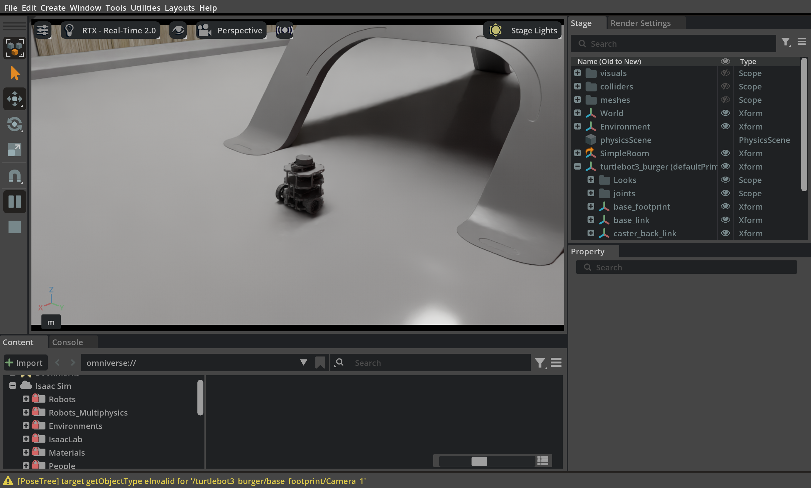
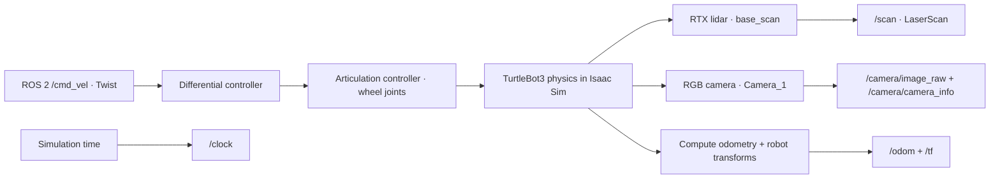
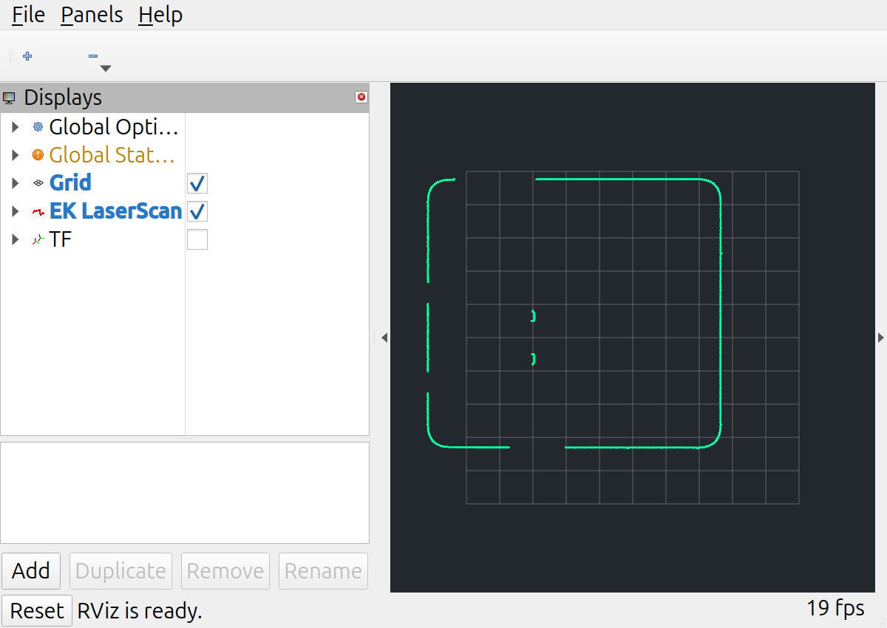
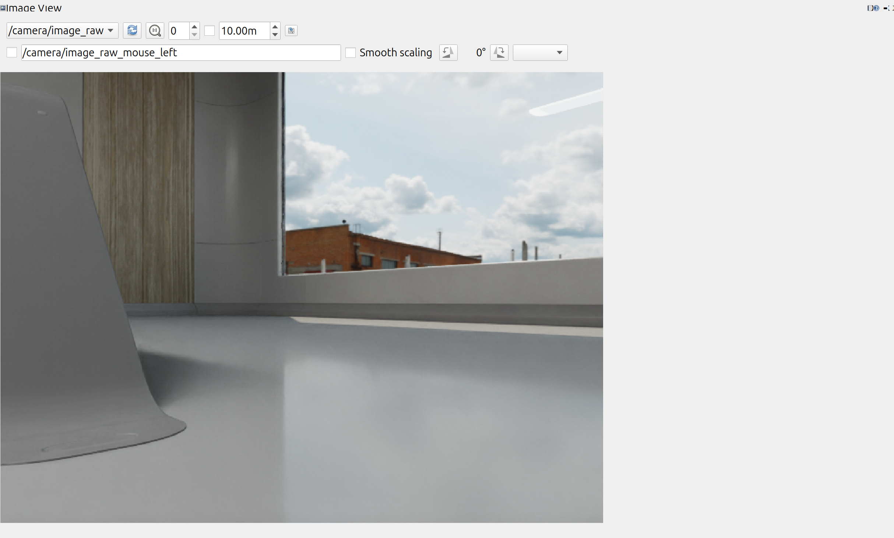

# TurtleBot3 ROS 2 Integration in Isaac Sim

**Motion control, RTX lidar, RGB camera, odometry, and TF — with recorded validation.**

A robotics systems integration project by **Elijah Koiki**, developed from the RAS 545 Lab 3 starter scene and instructions. The project connects a TurtleBot3 Burger to ROS 2 through Isaac Sim Action Graphs. This public showcase contains selected code, validation logs, screenshots, and a demo from the completed integration. Six incremental USD checkpoints are retained in the original local submission.

**Stack:** NVIDIA Isaac Sim 6.0.1 · ROS 2 Jazzy · Python · OmniGraph · OpenUSD · RViz2 · Fast DDS

[Demo video](lab/EK_Video/EK_Demonstration.mp4) · [Engineering notes](docs/engineering-notes.md) · [Run the project](docs/reproduction.md) · [Validation evidence](docs/validation.md)



*TurtleBot3 in the packaged room during the recorded A–F integration run.*

## What this project demonstrates

- **ROS 2 integration:** simulation time, velocity commands, sensor messages, odometry, and transforms connected through five Action Graphs in the final scene.
- **Mobile robot control:** `/cmd_vel` Twist commands converted into left and right wheel velocities using a differential-drive controller.
- **Sensor and frame configuration:** RTX lidar and a 640 × 480 RGB camera published with matching frame IDs and a connected seven-edge TF tree.
- **Debugging and reproducibility:** external-process ROS validation and recorded checks of geometry dependencies and checkpoint consistency.

The focus is the integration and verification of a supplied robot model. Robot geometry and physics come from the course starter.

## Recorded results

The archive contains two distinct validation runs. The results below are retained evidence from the supplied submission.

| Check | Recorded result | Source |
| --- | --- | --- |
| Commanded motion | 0.361 m forward displacement; 1.059 rad yaw change; stop check passed | [Motion summary](lab/EK_Logs/EK_acceptance_summary.json) |
| Lidar after reopening | 167 LaserScan messages; 3,600 ranges in the captured sample | [Fresh-process log](lab/EK_Logs/EK_fresh_process_validation.json) |
| Camera after reopening | 100 RGB images; 167 CameraInfo messages; 640 × 480 `rgb8` | [Fresh-process log](lab/EK_Logs/EK_fresh_process_validation.json) |
| Odometry and simulation time | 1,009 odometry messages and 1,010 clock messages after reopening | [Fresh-process log](lab/EK_Logs/EK_fresh_process_validation.json) |
| TF structure | Seven required edges received; no `world → odom` edge observed | [TF evidence](lab/EK_Evidence/EK_F_tf_tree.png) |
| Checkpoint packaging | Geometry and physics fingerprints matched before and after sharing the robot geometry layer, across all six checkpoints | [Comparison log](lab/EK_Logs/EK_geometry_equivalence.json) |

These are simulation observations, not physical robot accuracy measurements. Wall-clock arrival rates vary with rendering and GPU load; [validation details](docs/validation.md) keep them separate from configured simulation frequencies.

## System architecture



The recorded TF chain is `odom → base_footprint → robot and sensor links`. Simulation time timestamps the sensor, odometry, and TF streams.

## See the output

| Lidar in RViz2 | Robot camera in rqt_image_view |
| --- | --- |
|  |  |

**[Open the recorded demonstration](lab/EK_Video/EK_Demonstration.mp4)** for commanded motion and the ROS visualizations. GitHub may offer a download for the repository video file.

## Engineering decisions

| Problem encountered | Resolution documented in the submission |
| --- | --- |
| ROS message type-support error when mixing Isaac Sim and system Python libraries | Run the ROS subscriber validation in a separate system Python process. |
| Missing room geometry after reopening the package | Include the referenced room props locally and validate the final stage in a fresh process. |
| Conflicting camera orientations in the lab instructions | Use the forward-facing E4 orientation and retain the camera view and TF evidence. |
| Stale saved render products and rotary RTX sensing requirements | Create fresh render products on Play and enable Motion BVH. |

Read the [engineering notes](docs/engineering-notes.md) for the evidence, tradeoffs, and remaining limitations.

## Explore or reproduce

**No simulator needed to review the saved evidence:**

```bash
python3 scripts/check_saved_evidence.py
```

This checks the recorded topic reception, expected TF edges, sensor fields, retained motion result, and checkpoint comparison records. It does not run a new simulation.

**To understand or reconstruct the setup:** follow the [reproduction notes](docs/reproduction.md). The original course starter, packaged USD checkpoints, raw third-party models, and course report are not redistributed in this public showcase. The graph builder is retained as implementation evidence and requires the original course scene to execute.

```text
lab/
├── EK_Code/           Graph builder, external ROS validator, commands, RViz config
├── EK_Logs/           Selected motion, topic, TF, and checkpoint records
├── EK_Evidence/       Selected scene, graph, sensor, and TF screenshots
└── EK_Video/          Recorded demonstration
scripts/              Saved-evidence checker
docs/                Engineering notes, validation, reproduction, provenance
```

## Scope and credits

Completed scope is the **A–F integration**: physics inspection, clock, differential drive, lidar, camera, odometry, and TF. AMCL localization, mapping, and Nav2 goal execution are outside this project's demonstrated results. The submission records instructor check-off as pending.

Automated assistance was used for simulation operation, graph-script repairs, evidence collection, report assembly, and this portfolio presentation. See [project provenance](docs/provenance.md) for the contribution record.

Based on [RAS 545 Lab 3](https://tatwik19.github.io/labs/lab-03-isaac-sim/) by Sai Srinivas Tatwik Meesala, Rajesh S Aouti, and Prajval Arora, under Prof. Sangram Redkar. Course starter and NVIDIA assets retain their respective ownership and terms. Raw third-party scene assets are excluded from this showcase. See [provenance and attribution](docs/provenance.md).
