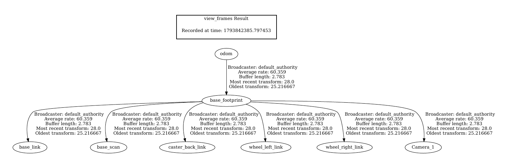

# Validation evidence

The values below come from the submitted archive dated November 4, 2026. Portfolio preparation checked the original archive checksums before selecting these records; it did not repeat the GPU simulation.

## Two recorded runs

The [original external validation](../lab/EK_Logs/EK_live_validation.json) recorded the commanded motion sequence. A separate [fresh-process validation](../lab/EK_Logs/EK_fresh_process_validation.json) checked the final packaged stage after reopening. Counts and rates should be interpreted within their own run.

| ROS topic | Message type | Original count | Original wall Hz | Fresh-process count | Fresh-process wall Hz |
| --- | --- | ---: | ---: | ---: | ---: |
| `/clock` | `rosgraph_msgs/msg/Clock` | 772 | 24.16 | 1,010 | 31.85 |
| `/scan` | `sensor_msgs/msg/LaserScan` | 129 | 4.03 | 167 | 5.41 |
| `/camera/image_raw` | `sensor_msgs/msg/Image` | 73 | 2.28 | 100 | 3.30 |
| `/camera/camera_info` | `sensor_msgs/msg/CameraInfo` | 129 | 4.03 | 167 | 5.41 |
| `/odom` | `nav_msgs/msg/Odometry` | 771 | 24.15 | 1,009 | 31.85 |
| `/tf` | `tf2_msgs/msg/TFMessage` | 1,542 | 48.33 | 2,018 | 63.73 |

Rates are subscriber arrival measurements against a monotonic wall clock. They are not configured sensor frequencies, real-time factors, or benchmark guarantees. A TF message may contain multiple transforms; TF message count is different from the count of unique TF edges.

## Motion

The [motion summary](../lab/EK_Logs/EK_acceptance_summary.json) reports 0.360553 m forward displacement, 1.058876 rad yaw change, and a passed stop check. The recorded stop displacement is about `5.96e-8 m`; this numerical simulation value is not a physical accuracy claim. The underlying run retains sampled position and quaternion-z values, rather than a full timestamped quaternion trajectory suitable for a new orientation accuracy analysis.

The external validation sends forward commands at 0.12 m/s, zero commands, angular commands at 0.5 rad/s, and a final zero command over a roughly 32-second wall-clock session. The test window is based on wall time, so simulated travel varies with simulation speed and scheduling.

## Transform structure

Both saved runs contain these seven edges:

```text
odom
└── base_footprint
    ├── base_link
    ├── base_scan
    ├── caster_back_link
    ├── wheel_left_link
    ├── wheel_right_link
    └── Camera_1
```

No `world → odom` edge was observed in either capture. The logs establish the observed tree during the test windows; they do not prove the absence of every possible publisher outside those windows.



## Evidence review without Isaac Sim

From the repository root:

```bash
python3 scripts/check_saved_evidence.py
```

The checker uses the Python standard library. It confirms positive counts for all six saved streams, compares exact expected TF edges, checks image and lidar sample fields, and checks the retained acceptance summary and checkpoint equivalence records. It exits nonzero if a check fails.

The checker validates consistency and integrity of retained evidence. It does not independently reproduce the original measurements. Follow the [reproduction guide](reproduction.md) for a new live run.
